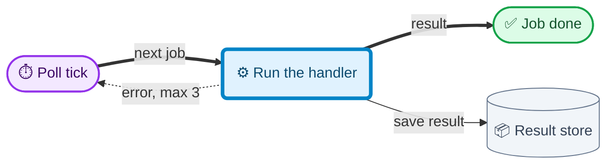
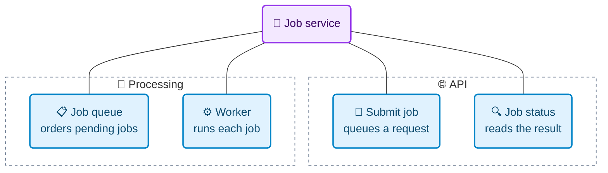
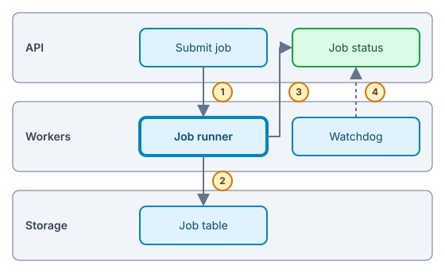

# Illustration Kinds

Patterns beyond a plain workflow. Each one answers a different question; style
and colors still follow [diagram-style.md](diagram-style.md) and
[palette.md](palette.md). The examples illustrate an imaginary job queue.

## Contents

- Mechanism: how an engine runs
- Anatomy: what it is made of
- Layout: what sits where
- Chart: how a number evolves
- Data recap: what the numbers say

## Mechanism: how an engine runs

The question: what drives it, what turns, what comes out. An engine is a loop
fed by an input and leaking an output; draw that loop, not its components list.

- **Input → transformation → output** on the main path (`==>`), left to right.
- **The cycle** that keeps it running closes with a `-.->` edge labelled with
  its tempo or trigger (`each tick`, `every 30s`, `on event`).
- **The driving force** (a clock, a queue, a user action) is the `entry` node;
  the part that does the real work is the single `focus`.
- **State that persists** between turns is a cylinder `[("…")]` with its
  `read`/`write` edges.
- Name what moves on each edge: a message, a score, a frame, a lock.



## Anatomy: what it is made of

The question: which parts it has and what each one is for. A labelled
dissection: the whole at the top, its parts below, each with one job.

- One root node, the subject; one level of parts under it, two at most.
- Each part's label holds its name and its job (`Worker<br/>runs each job`).
- Group parts by role in `subgraph` frames (`🌐 API`, `🧠 Processing`,
  `💾 Storage`), at most 4 groups of 7.
- Edges are plain `---` ownership lines, unlabelled; flows belong in a
  mechanism, not in an anatomy.
- Spatial anatomy (where each part sits on a screen, a cutaway, an exploded
  view) needs positions Mermaid cannot keep: draw it in SVG
  ([svg.md](svg.md)) with numbered callouts and leader lines to each part.



## Layout: what sits where

Layered stacks, screens split into zones and timelines to scale are spatial:
Mermaid reflows them. Hand-author SVG ([svg.md](svg.md)):

- Stacks read top to bottom, highest abstraction on top, one band per layer.
- Screen anatomy: the frame drawn to its real ratio, zones as palette chips,
  numbered callouts outside the frame.
- Timelines: one axis to scale, events as ticks with a one to three word label.
- Callouts: numbered amber circles beside the arrow they explain; the caption
  lists each number with its meaning.

The reference drawing, passed by `lint-svg.mjs`:



1. Submit sends the job to the runner. 2. The runner writes the result.
2. The status reads `done` or `failed`. 4. The watchdog marks a stuck job
   timed out (dashed: fallback).

`block-beta` rejects `accTitle` and `timeline` drops it: never use them.

## Chart: how a number evolves

The question: how a value changes over time or compares across items. Use
`xychart-beta`, always with the measured series color of
[palette.md](palette.md): Mermaid's default is invisible on white.

- The title states the finding (`"Build time halved"`), not the metric name;
  the axis titles carry the unit (`"Minutes per build"`).
- `line` for a trend over an ordered axis, `bar` for a comparison of items,
  sorted largest first unless the axis has its own order; 12 bars at most.
- One series per chart: `xychart-beta` draws no legend, so a second series
  differs by color alone. Compare series in two charts or a table.
- Bars start at zero; a line not starting at zero says so in its axis title.
  No second y-axis, no 3D, no pie (angles compare badly).
- Every value comes from a named source (query, file, run) listed under
  `Sources`; no rounded guess, no extrapolated point.
- Screen readers cannot read a curve: put the values in a table right under
  the chart (WCAG 1.1.1).

The values below are placeholders showing the shape, not data:

```mermaid
%%{init: {"themeVariables": {"xyChart": {"plotColorPalette": "#0284C7"}}}}%%
xychart-beta
    accTitle: Build time per week
    accDescr: Build time halved after the cache landed in week 3.
    title "Build time halved"
    x-axis "Week" [W1, W2, W3, W4, W5]
    y-axis "Minutes per build" 0 --> 20
    line [16, 15, 9, 8, 8]
```

| Week | Minutes per build |
| ---- | ----------------: |
| W1   |                16 |
| W2   |                15 |
| W3   |                 9 |
| W4   |                 8 |
| W5   |                 8 |

## Data recap: what the numbers say

A recap of a few figures is a Markdown table, sorted by the column the
takeaway is about, the key row in bold. Reach for a chart only past about 7
values or when the shape (a peak, a drop, a plateau) is the takeaway.
